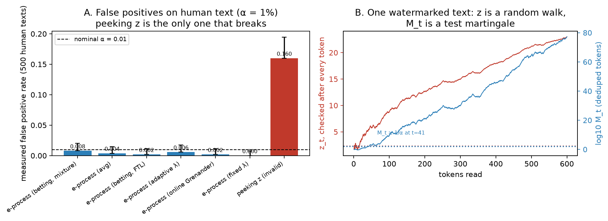
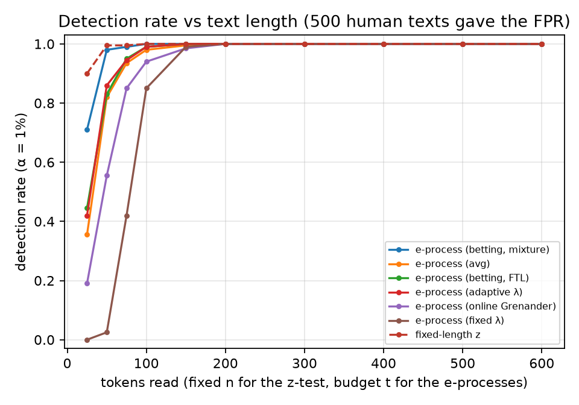
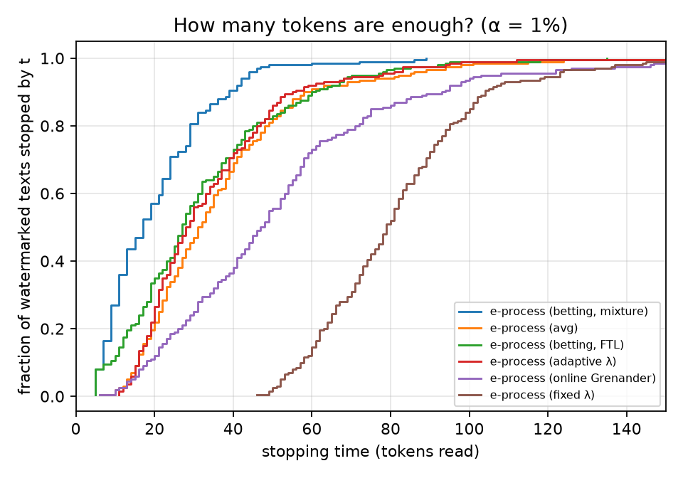
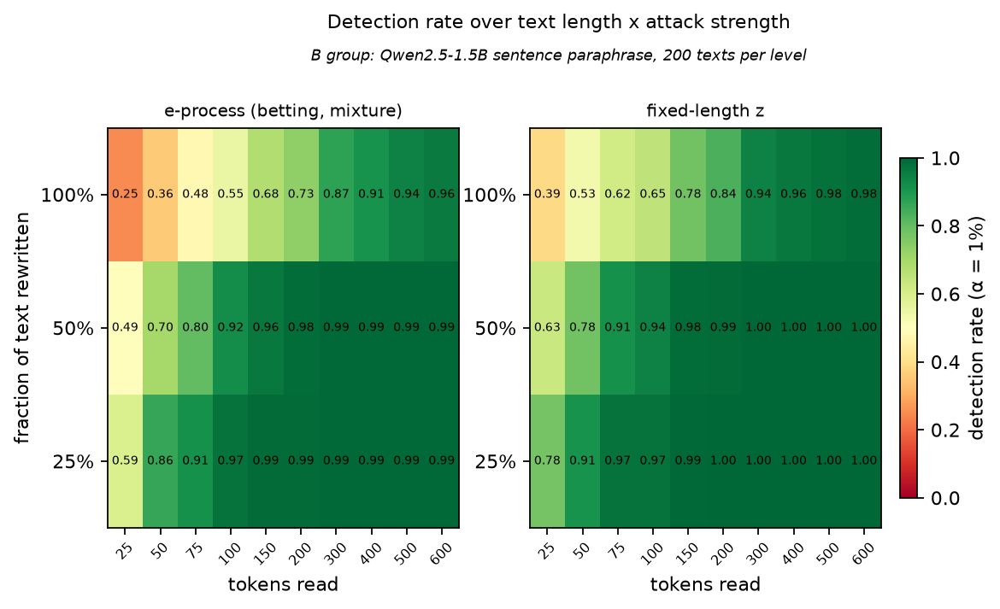
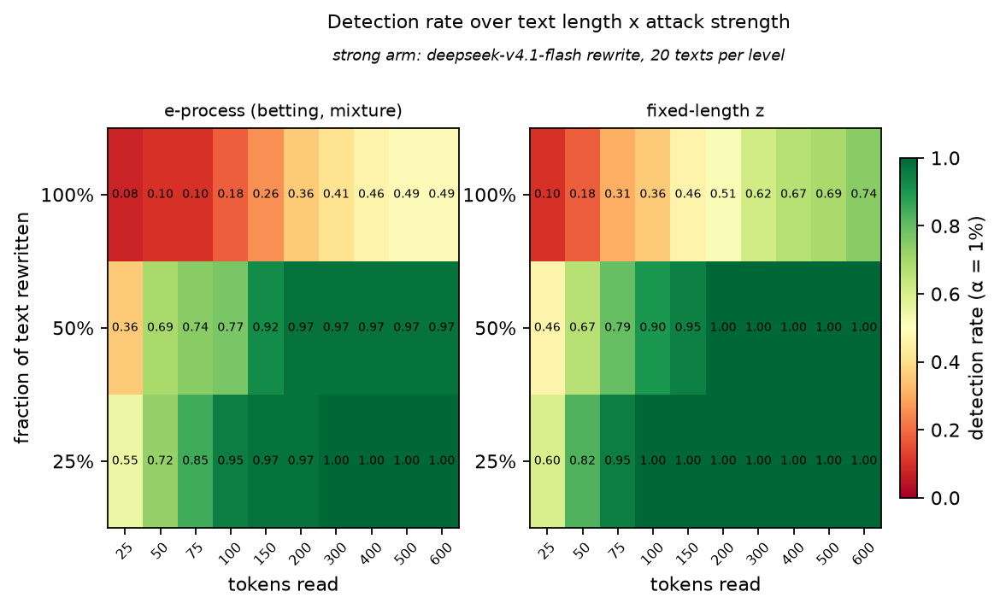

# KGW 水印证据的在线检测与鲁棒性评估

**C 组（检测与统计）报告**

---

## 摘要

本项目研究的问题是：**在什么条件下，"这段文本带水印"这个结论才能当作证据。**

我们以 KGW 水印（Kirchenbauer et al. 2023）为对象，把每个 token 的绿/红旗标转换成一个零假设下均匀分布的 p 值，
再套用 Su, Wang & Zhao (2026) 的 e-process 框架，得到一个**可以在任意时刻停下来下结论**的检测器。
在这个基础上，我们在 500 条人写文本、200 条水印文本和 1187 条被攻击的水印/人写文本上，
测了误报率、检验力、停止时间，以及"证据强度"如何随文本长度和攻击强度变化。

主要结果：

1. **误报率守得住。** α = 1% 时，五种 e-process 的实测误报率为 0.000–0.008（500 条人写文本，
   Wilson 上界 ≤ 0.020）；而在同一个 z 统计量上"每读一个 token 就看一次"，实测误报率是 **0.160**
   （α = 5% 时 0.434）。
2. **需要多长有明确数字。** 干净水印文本中位数 **17 个 token** 就能停（90% 分位 39）；
   若要求 90% 的文本都能检出，需要 50 个。
3. **攻击把所需长度推长，但没有把信号归零。** 逐句改写 25% / 50% / 100% 后，
   达到 90% 检出所需长度从 50 变成 **75 / 100 / 400** 个 token；换成更强的改写模型
   （deepseek-v4.1-flash，token 存活率从 0.553 降到 0.404），100% 档读满 600 个 token 也只有 0.46。
   但 100% 改写后绿色比例仍为 **0.404 / 0.332**，显著高于无水印时的 γ = 0.25 ——
   **水印被削弱，而不是被消除。**
4. **攻击不会制造假阳性。** 被同样改写的人写文本（719 条）绿色比例 0.229–0.238，
   α = 1% 下 400 个 token 内的检出率为 0–0.025。
5. **"α = 1%" 是对密钥平均的 1%。** 同一批人写文本换 6 把 hash key，绿色比例从 0.237 漂到 0.257，
   α = 5% 时的实测误报率从 0.008 漂到 0.026。

---

## 1 研究问题

水印检测经常被简化成一个二分类准确率，但实际部署时要回答的是**证据问题**：
给定一段长度未知、可能被改写过、长度和内容都不可控的文本，"它带水印"这个判断有多大把握？
这个问题有四个轴，任何一个没交代清楚，结论就无法复核：

| 轴 | 具体问题 |
|---|---|
| 长度 | 读了多少个 token？结论是在第几个 token 上成立的？ |
| 攻击 | 文本被改写过多少？改写强度怎么度量？ |
| 显著性 | 允许的误报率 α 是多少？是否考虑了"边读边看"？ |
| 密钥 | 用的是哪把 hash key？换一把会怎样？ |

本文的目的是把四个轴都钉死：每个结论都同时给出长度、攻击强度（客观指标）、α 和密钥。

---

## 2 背景：KGW 水印与逐 token 旗标

KGW 用前一个 token 和一把秘密整数 `hash_key` 生成当前 token 的绿名单：

```
seed   = hash(hash_key, w_{t-1})
perm   = randperm(V, seed=seed)          # V = 151936
G(w_{t-1}) = perm[: γV]                  # 绿名单，占词表比例 γ
```

生成时把绿名单内 token 的 logit 加 δ；检测时只看每个位置是否落在绿名单里，得到 0/1 旗标

```
flag_t = 1{ w_t ∈ G(w_{t-1}) }        H0（无水印）下  flag_t ~ Bernoulli(γ)
```

本项目固定 γ = 0.25、δ = 2.0（`configs/KGW_g025.json`）。在这个配置下，
水印文本的绿色比例理论值为 `γ + δγ(1−γ) = 0.625`，实测 **0.627**（200 条 × 600 token）；
无水印文本的绿色比例应为 γ = 0.25，实测人写文本 **0.237**、AI 写但不加水印 **0.243**。

**旗标本身不是证据。** 绿比例高于 γ 只是描述性统计：它没有考虑读了多少 token、
没有给出犯错的概率，也无法回答"现在停下来算不算数"。要把它变成证据，需要假设检验的框架。

---

## 3 方法

### 3.1 从旗标到 p 值（本文的关键一步）

Su et al. (2026) 的框架要求每个 token 提供一个**零假设下均匀分布**、且与过去独立的随机变量 `Y_t`
（论文 Assumption 1）。KGW 给的是 Bernoulli(γ) 的 0/1 旗标，**不能直接代入**。
我们加一步映射：

```
flag = 1（绿）  →  p = γ·U
flag = 0（红）  →  p = γ + (1−γ)·U        U ~ Uniform(0,1)
```

**命题.** 若 `flag ~ Bernoulli(γ)`，则上式给出的 `p` 在 H0 下精确服从 Uniform(0,1)，
且不同 token 之间独立（条件于各自的 U）。

*证明.* 绿的概率质量 γ 被均匀铺在 `[0, γ]` 上，红的概率质量 (1−γ) 被均匀铺在 `[γ, 1]` 上，
两段恰好拼成 `[0,1]` 上的均匀分布。∎

若 `flag` 在 H1 下更常取 1（绿概率 q > γ），则 p 随机地更小 —— 这正是论文 H1 需要的"super-uniform 的对立面"。
另提供一个保守模式（`mode="disc"`）：绿 → p = γ，红 → p = 1，不需随机数，但检验力略低。
随机化是检验的一部分，因此**每条文本使用独立的随机种子**（`doc_seed = crc32(文本 id)`），
不能整个文件共用一个种子（见 §7）。

### 3.2 e-process

一个非负过程 `M_t` 若满足 `E_{H0}[M_t | M_{t−1}] ≤ M_{t−1}`（即 H0 下是上鞅），就称为 e-process。
由 Ville 不等式：

```
P_{H0}( ∃t : M_t ≥ 1/α ) ≤ α       对任意停时成立
```

也就是说：**任何时刻**只要 `M_t ≥ 1/α` 就可以拒绝 H0，误报率仍然不超过 α，
不需要预先承诺读多少 token。"读到够为止"不额外收费 —— 这是 z-test 做不到的。

我们实现并比较了六种构造（前四条来自论文 §4，后两条是本项目的扩展）：

| 名称 | 每步证据因子 | λ 的处理 | 用到什么信息 |
|---|---|---|---|
| `nonadapt` | `E_t = 1 − λ + λ·g(p_t)`，`g(p) = −log p` | 固定 λ = 0.1 | p 的大小 |
| `wadapt` | 同上（论文 eq.9/11） | λ_t 由过去表现（FTL）决定 | p 的大小 |
| `og` | `E_t = f_t^{OG}(p_t)`（论文 eq.12–14） | 无 λ，直接输出密度值 | 过去 p 的分布形状 |
| `avg` | `M_t = ½·M_t^{wadapt} + ½·M_t^{OG}`（论文 eq.15） | 两者各自处理 | 两者 |
| `bet` | `E_t = 1 + λ_t·(flag_t − γ)` | λ_t 由 FTL 决定，λ ≤ 1/γ | 只用 0/1 |
| `betmix` | `M_t = mean_j Π_s (1 + λ_j·(flag_s − γ))` | 对 λ 网格取**混合** | 只用 0/1 |

其中 `og` 的 `f_t` 是对过去 p 值做在线 Grenander 估计（最小凹majorant）得到的递减密度，
只依赖过去，因此 `f_t` 可料，`Π f_t(p_t)` 仍是 e-process。
`bet`/`betmix` 基于一个观察：KGW 的信号恰好是 Bernoulli 参数的偏移，
把每一步当成对"这个 token 是绿的吗"下注（Kelly 下注），`λ = 1/γ` 时绿 token 让财富乘以 4。
`betmix` 是 `bet` 的 λ 混合版：混合后的过程仍是 e-process（e-process 的凸组合仍是 e-process），
但它不承诺某一个 λ，理论上只比最好的固定 λ 多付 `log(#λ)` 的代价。

判据统一为 `M_t ≥ 1/α`；报告中的"第几个 token 检出"一律用 `max_{t≤n} M_t`（见 §7）。

### 3.3 两个对照检测器

| 名称 | 定义 | 性质 |
|---|---|---|
| `fixed_z` | `z = (G_t − γt)/sqrt(tγ(1−γ))`，在**事先指定**的 n 上看一次，`z > z_threshold(α)` 就拒绝 | 只在那个 n 上控制误报率 |
| `peeking_z` | 每个 t 都算 z，只要**存在**某个 t 超过阈值就拒绝 | 未校正多重比较，误报率失控（§5.2 实测） |

`z_threshold(α)` 由正态分位数计算（α = 1% → 2.326），不沿用配置文件里名义的 4.0。

### 3.4 去重

旗标是 `(w_{t−1}, w_t)` 的确定性函数，所以同一个 bigram 重复出现时，重复的是**同一枚硬币**，
不是新证据。我们为每条文本计算 `first_occurrence` 掩码，只对首次出现的 bigram 计分。
实测去重保留 87%–93% 的 token（攻击后文本重复更多，保留率更低）。

### 3.5 判定与实现约定

- 拒绝 H0（判为"带水印"）当且仅当 `max_{t≤n} M_t ≥ 1/α`；
- α 取 1% / 5% / 10% 三档做完整网格；
- 绿名单在 CPU 上计算（`kgw_cpu.py`，`patch_kgw_cpu`），保证不同显卡/机器上检测结果逐 bit 一致；
- 除 `extract_flags.py`（需要 torch + MarkLLM）外，全部统计代码只用 numpy，单机数秒即可重算。

---

## 4 数据与实验设置

### 4.1 语料

| 文件 | 条数 × token | 来源 | 说明 |
|---|---|---|---|
| `data/prompts.jsonl` | 200 × 50 | C4 新闻 | 续写起点（文章前 50 token） |
| `data/human.jsonl` | 500 × 600 | C4 新闻 | 人写文本，**不含水印**（与 prompts 无重叠） |
| `data/wm.jsonl` | 200 × 600 | Qwen2.5-1.5B-Instruct + KGW | 水印文本 |
| `data/nowm_local.jsonl` | 50 × 600 | 同一模型，关闭水印 | AI 文本的 null 对照（与 wm 同 prompt，可配对） |
| `data/attacked_wm.jsonl` | 600（有效 588） | B 组攻击 | 200 篇 × 3 档 |
| `data/attacked_human.jsonl` | 600（有效 599） | B 组攻击 | 人写文本的同款攻击（对照） |
| `data/attacked_api.jsonl` | 240（有效 238） | 本项目攻击 | 20 篇 × 3 档 × 2 种 prompt（强攻击臂） |

### 4.2 两条攻击臂

| | 主臂（B 组，`B/attack.py`） | 强臂（本项目，`c_eprocess/attack_rewrite.py`） |
|---|---|---|
| 攻击模型 | Qwen2.5-1.5B-Instruct，无水印 | deepseek-v4.1-flash（dtens API） |
| 改写方式 | 逐句改写，三档**嵌套**（25% ⊂ 50% ⊂ 100%） | 同样逐句改写，另分 light/strong 两种 prompt |
| 质量过滤 | 语义相似度 ≥ 0.75（all-MiniLM-L6-v2）+ 人工复核 12 条剔除 | 长度比 0.4–2、数字不变、非空、非重复 |
| 规模 | 200 篇/档 | 20 篇/档 × 2 prompt |
| 有效条数 | 197 / 196 / 195 | 40 / 39 / 39 |

两条臂的存在使"攻击强度"成为**可测的轴**而不是一个标签：同一套检测器、同一个 α，
只改变攻击者，就能看到所需长度如何变化。

### 4.3 攻击强度的客观指标

对每个被攻击文本，用最长公共子序列（`difflib.SequenceMatcher`，关闭 autojunk）计算：

- `token_kept` = 原文 token 中存活的比例（1.0 = 没改，0.404 = 六成被替换）；
- `unigram_new` = 改写后新出现的 token 比例；
- 主臂另有 `token_edit_ratio`、`sim`（语义相似度）、`actual_attack_frac`（实际改写句子比例）。

| 臂 | token_kept（25 / 50 / 100%） | unigram_new |
|---|---|---|
| 主臂 | 0.883 / 0.774 / **0.553** | 0.082 / 0.158 / 0.313 |
| 强臂 | 0.832 / 0.685 / **0.404** | 0.123 / 0.231 / 0.443 |

需要注意：主臂"名义 100%"档实际只改写了 68.6% 的完整句子（改写失败时保留原句），
其 token 存活率 0.553 已经比强臂 50% 档（0.685）更狠，但仍明显弱于强臂 100% 档。

### 4.4 评估协议

- **误报率**：500 条人写文本逐条判定，报告 `k/N` 与 Wilson 95% 区间；α = 1%、5%、10% 全覆盖；
  去重开/关各一份。
- **检验力**：200 条水印文本在 n = 25…600 各前缀上"是否已越过 1/α"的比例；
  `by(M)[:, n−1]` 即 `max_{t≤n} M_t`。
- **所需长度 `L*`**：90% 检出所需的最小 n，在
  n ∈ {25, 50, 75, 100, 150, 200, 300, 400, 500, 600} 上搜索；若到 600 仍未达 90% 记为"不可靠"。
  它与"中位停止时间"不是同一个量：后者是 50% 分位。
- **停止时间分布**：报 p10/p25/p50/p75/p90 与"600 token 内未停"的比例。
- **同误报率比较**：把 z 的阈值校准到 e-process 的实测误报率，再比较两者的检验力。

---

## 5 结果

### 5.1 环境一致性

绿名单必须与机器无关。`verify_kgw.py` 对整个文件重算并输出逐 token 指纹：
`data/wm.jsonl → flags_md5 = 5d98d773dd`、`data/human.jsonl → 6375f943cb`。
这两个值与 A 组在 Linux + torch 2.5.1 (CARC) 上得到的结果**逐 bit 相同**；
本项目在 Windows + torch 2.6.0 + RTX 3060 Ti 上复现，仍相同。
因此后续所有检测统计在任何机器上都可复现。

### 5.2 误报率：e-process 守得住，peeking 守不住

500 条人写文本，去重开启：

| 检测器 | α = 10% | α = 5% | α = 1% |
|---|---|---|---|
| `betmix` | 0.042 [0.028, 0.063] | 0.026 [0.015, 0.044] | **0.008** [0.003, 0.020] |
| `avg` | 0.016 [0.008, 0.031] | 0.008 [0.003, 0.020] | **0.004** [0.001, 0.015] |
| `bet` | 0.040 [0.026, 0.061] | 0.008 [0.003, 0.020] | **0.002** [0.000, 0.011] |
| `wadapt` | 0.034 [0.021, 0.054] | 0.014 [0.007, 0.029] | **0.006** [0.002, 0.018] |
| `og` | 0.012 [0.005, 0.026] | 0.006 [0.002, 0.018] | **0.002** [0.000, 0.011] |
| `nonadapt` | 0.028 [0.017, 0.046] | 0.008 [0.003, 0.020] | **0.000** [0.000, 0.008] |
| `fixed_z`（n = 600 看一次） | 0.050 [0.034, 0.073] | 0.024 [0.014, 0.042] | **0.006** [0.002, 0.018] |
| **`peeking_z`（每 token 看一次）** | **0.532** [0.488, 0.575] | **0.434** [0.391, 0.478] | **0.160** [0.131, 0.195] |

全部 e-process 的实测误报率都不超过其名义 α（区间上界与 α 相容），
`peeking_z` 则把名义 1% 变成实测 16%，名义 10% 变成 53%。
差异的唯一来源是"看了几次"，与统计量本身无关 —— 这正是序贯检验要解决的问题。



### 5.3 检验力与停止时间

200 条水印文本，α = 1%：

| 检测器 | n = 25 | n = 50 | n = 100 | 中位停止 | p90 | 600 内未停 |
|---|---|---|---|---|---|---|
| `betmix` | **0.710** | **0.980** | 1.000 | **17** | 39 | 0 |
| `bet` | 0.445 | 0.830 | 0.990 | 27 | 60 | 0 |
| `wadapt` | 0.420 | 0.860 | 0.990 | 28 | 55 | 0 |
| `avg` | 0.355 | 0.820 | 0.980 | 31 | 58 | 0 |
| `og` | 0.190 | 0.555 | 0.940 | 47 | 93 | 0 |
| `nonadapt` | 0.000 | 0.025 | 0.850 | 79 | 104 | 0 |
| `fixed_z`（已知 n 单次检验） | **0.900** | 0.995 | 1.000 | — | — | — |

两个观察：

1. `betmix` 明显优于论文推荐的 `avg`：中位停止 17 vs 31 个 token，25 个 token 时的检出率 0.71 vs 0.36。
   原因在 §6.2 讨论。
2. **短前缀上 `fixed_z` 更强**（25 token：0.90 vs 0.71）。这是"随时可停"的价格：
   e-process 必须对所有停止时刻同时守住 α（并集上界），因此在任何**指定**长度上都不如
   专门为该长度校准的单次 z 检验。但一旦不能预先承诺长度，z 就无法使用（§5.2），
   而 e-process 的中位停止只要 17 个 token。





### 5.4 同实测误报率下的比较

把 z 的阈值按 e-process 的实测误报率校准（`betmix` 实测 0.008 → z > 1.981），
在 n = 600 时两者检出率都是 1.000。差别不在"最终能不能检出"，而在两处：
n < 100 的场景（`fixed_z` 需要预先知道 n）和"读到够为止"的场景（`betmix` 中位 17 个 token 就能停）。

### 5.5 攻击下的证据

α = 1%、去重、`betmix`：

| 改写档 | 主臂 green | 主臂 **L\*** | 主臂 400 token 检出率 | 强臂 green | 强臂 **L\*** | 强臂 400 token 检出率 |
|---|---|---|---|---|---|---|
| 0% | 0.627 | **50** | 1.000 | 0.627 | 50 | 1.000 |
| 25% | 0.569 | **75** | 0.995 | 0.558 | 100 | 1.000 |
| 50% | 0.514 | **100** | 0.995 | 0.479 | 150 | 0.974 |
| 100% | **0.404** | **400** | 0.908 | **0.332** | **不可靠** | 0.462 |

主臂 100% 档的完整曲线（`betmix`）：
n = 25 → 0.246、50 → 0.359、75 → 0.477、100 → 0.554、150 → 0.677、200 → 0.733、300 → 0.872、
400 → 0.908、500 → 0.944、600 → 0.959。





三条结论：

1. **"能不能检出"取决于愿意读多长。** 主臂 100% 档在 25 个 token 时只有 0.246，读 400 个到 0.908。
   任何"检出率 xx%"的说法如果不带长度，都没有信息量。
2. **所需长度随攻击强度单调增加且跨臂可比**：50 → 75 → 100 → 400（主臂），50 → 100 → 150 → >600（强臂）。
   两臂在 100% 档相差一个量级，原因不在检测器，而在攻击强度本身（token 存活率 0.553 vs 0.404）。
3. **信号没有被消除。** 100% 改写后绿色比例 0.404（主臂）/ 0.332（强臂），
   比无水印时的 0.25 高出 0.08–0.15，且强臂在 600 个 token 上的检出率仍有 0.462。
   残余偏差每 token 约 0.08，600 个 token 累积的证据约 5–9 nats，刚好在 `log(1/α) = 4.6` 的边界上。

### 5.6 对照：攻击不制造假阳性

| 对照组 | 条数 | green 比例 | α = 1% 下 400 token 检出率（25/50/100%） |
|---|---|---|---|
| 人写，被主臂改写 | 199 / 200 / 200 | 0.235 / 0.235 / 0.236 | 0.005 / 0.000 / 0.010 |
| 人写，被强臂改写 | 40 / 40 / 40 | 0.230 / 0.231 / 0.238 | 0.000 / 0.025 / 0.000 |
| AI 写，不加水印 | 50 | 0.244 | α = 1% 时 0/50 拒绝；α = 5% 时 3/50 |

因此攻击后水印文本检出率的下降，不能用"攻击让文本更像水印"来解释，也不能用"检测器在攻击文本上更保守"来解释：
对照组的判定行为与干净人写文本完全一致。

### 5.7 密钥风险

同一批 500 条人写文本，换 6 把 hash key（`results/keys/summary.csv`，检测器为 `bet`）：

| hash_key | 人写 green | α = 10% | α = 5% | α = 1% |
|---|---|---|---|---|
| 15485863（主实验用） | 0.2368 | 0.040 | 0.008 | 0.002 |
| 15485867 | 0.2431 | 0.042 | 0.014 | 0.004 |
| 15485891 | 0.2495 | 0.062 | 0.018 | 0.004 |
| 15485929 | 0.2569 | 0.068 | 0.026 | 0.006 |
| 15485941 | 0.2563 | 0.058 | 0.024 | 0.002 |
| 15485959 | 0.2504 | 0.050 | 0.026 | 0.006 |

6 把 key 都没有超过名义 α，但趋势清晰：同一批文本，换一把 key，
绿色比例从 0.237 漂到 0.257，α = 5% 的实测误报率从 0.008 漂到 0.026（约 3 倍）。
Ville 不等式给出的保证是对 (文本, 密钥) 联合随机性取的期望；真实部署中密钥是固定且保密的，
无法"平均"，所以**报"α = 1%"时必须说明这是对哪把密钥**。

作为流程校验，我们还验证了密钥的作用：同一批 200 条水印文本，
用正确的 key 得到 green 0.627、z 中位数 21.5、200/200 检出；
换成 15485867 后 green 0.247、z 中位数 −0.28、只有 4/200 越界（即 α = 1% 的正常误报水平）。

### 5.8 λ 的选择与自适应的代价

以最强的一档（强臂 100% 改写，残余偏差最小）为压力测试，读满 650 个 token：

| 方法 | 检出率 |
|---|---|
| `avg`（论文 eq.15） | 0.36 |
| `bet` + FTL 选 λ（论文 eq.9/11 的读法） | 0.49 |
| `betmix`（对 λ 取混合） | 0.49 |
| 固定 λ = 0.30（**oracle**：事后知道真实偏差） | **0.77** |

固定 λ 是作弊上界，不能用于实际检测，但它说明了一件事：**自适应不是免费的**。
这里的残余证据只有 5–9 nats，而"不知道 λ"要付 `log(#专家)`（2–5 nats）的代价，
在最弱信号上这足以把结论从"能检出"翻成"检不出"。
因此我们同时报告"最好的自适应结果"和"oracle 上界"，避免把 λ 的优势当成检测器的优势。

---

## 6 讨论

### 6.1 "一次改写即完全去除水印"不成立

用 50 个 token 判定"水印被 100% 去除"，混淆了两件事：**信噪比下降** 与 **信号消失**。
我们的数据显示：100% 改写后绿色比例仍有 0.404（主臂）/ 0.332（强臂），
对应的 z 统计量在多数文本上仍然是正的、显著的（主臂平均 z = 8.5）。
正确表述是：**100% 改写把"需要多少证据"从 50 个 token 推到了 400 个以上（更强攻击者则超过 600 个）**，
而不是"水印不存在了"。

### 6.2 为什么 `betmix` 比论文推荐的 `avg` 更紧

KGW 的信号**就是**一个 Bernoulli 参数的偏移：每个 token 只有"绿/红"两种结果。
`bet` 系列直接对这个 0/1 下注，每一步的期望对数增长率达到最优（Kelly），
因此它把全部信息都用在了信号上。

`avg` 用的是"p 值有多小"，而 p 值里的"大小"部分是我们用随机数 `U` 人工铺上去的
（§3.1 的映射），那部分不携带关于水印的信息。于是 `avg` 在红 token 上只得到极小的因子
（`1 − λ + λ·g(p)`，`g(p) = −log p` 对接近 1 的 p 几乎为 0），在绿 token 上也拿不到 `bet` 那样的 4 倍增长。
实测差距：25 个 token 上 0.71 vs 0.36，中位停止 17 vs 31。

这不是说 `avg` 无用：对 Gumbel-max 一类**本身就是连续 pivotal** 的水印，没有 0/1 旗标可用，
`bet` 无从下注，只能使用 `avg`/`og`。本项目只做 KGW（midterm 范围），因此以 `betmix` 为主检测器，
同时保留 `avg` 以与论文结果直接对照。

### 6.3 去重的代价

| | 去重开 | 去重关 |
|---|---|---|
| 人写文本误报率（α = 1%） | 0.008 | 0.008 |
| 强臂 100% 改写、600 token 检出率 | 0.49 | 0.62 |
| 保留 token 比例 | 87%–93% | 100% |

去重是理论上必需的（重复 bigram 是同一枚硬币，破坏独立性），但它在本数据上**只体现代价**：
人写文本的绿色比例本来就低于 γ，重复 bigram 没有制造出可观测的假阳性；
而在被改写文本上，重复 bigram 恰恰是"绿 token 重复出现"的那部分，去重会带走一部分检出率。
我们的处理方式是：默认开启（保证统计合法性），同时报告"不去重"作为敏感性分析。

### 6.4 anytime-validity 的价格

在**已知且固定**的长度上，单次 z 检验比 e-process 更省数据（25 个 token：0.90 vs 0.71）。
这不是实现问题，而是两个问题的答案不同：

- "我打算读 25 个 token，够不够？" → 固定长度 z，且必须在读之前就定好 n；
- "我边读边看，读到能下结论为止" → e-process，且不会因为多看了几次而失效。

实际部署更接近第二种（文本长度不可控、用户随时想要结论），而 peeking 的代价已经实测（§5.2）。

### 6.5 与论文的关系

论文（Su, Wang & Zhao 2026）的框架针对 Gumbel-max 这类自带均匀 pivotal 的水印，
并假定 H0 下 `Y_t ~ U(0,1)`。本项目的贡献是把该框架落到 KGW 上：

1. 补上 flag → p 值的映射，并证明其在 H0 下的精确均匀性（§3.1）；
2. 指出 KGW 专用下注过程（`bet`/`betmix`）显著优于论文通用的 `avg`；
3. 用真实人写文本、真实攻击数据给出误报率、所需长度、密钥与攻击强度的完整数据；
4. 给出"证据被削弱而非消除"的可复核度量。

---

## 7 实现中修正的问题

这些问题都在模拟或真实数据上复现过，记录在此以便复核：

| # | 现象 | 原因 | 修法 |
|---|---|---|---|
| 1 | "读 n 个 token 的检出率"随 n 下降 | `M_t` 遇红 token 会下降（betting/adaptive 非单调） | 一律用 `max_{t≤n} M_t`（`run_eval.py` 的 `by()`），与 Ville 的 `sup_t` 口径一致 |
| 2 | 两篇不同的人写文本出现完全相同的 `M_t = 103.0`；攻击后人写文本误报率 7.5% | p 值随机化共用了一个种子，全文件共享同一条 U 序列 | 每条文本用 `doc_seed = crc32(id)`，修复后 0/40 |
| 3 | `run_eval` 抛 `IndexError: index 599 out of bounds for axis 1 with size 599` | 补齐曲线时用了 `T = min(...)` | 改为 `T = max(...)` |
| 4 | OG 校准器 `∫f = 1.25`，不满足密度性质 | PAVA 池化方向写反 + 用累积质量代替累积分布 | 重写为最小凹 majorant；`selftest_sim.py` 增加四条性质检查 |
| 5 | `bet` 的财富出现 `log 0` | λ 网格取到了端点 `1/γ`，红 token 时 `E_t = 0` | 网格改为 `endpoint=False` 并去掉 0 点 |
| 6 | 攻击第一版 6 个变体全部 `content = null` | 推理模型把 256 个输出 token 全用于 `reasoning_content` | 请求加 `reasoning_effort: "none"`；1.5 s/256 token → 0.5 s/29 token |
| 7 | `betmix` 在首批攻击数据上 0/39 | 混合证据按 `terms−1` 参数化，符号与 `flag−γ` 不一致 | 改为 `x = flag − γ`、因子 `log1p(λx)` |
| 8 | 断点续跑后攻击数据只剩 1/3 | 续跑键只有 `id`，而同一 id 有 3 个 attack_frac | 键改为 `(id, attack_frac)` |

`selftest_sim.py` 在已知真值的合成数据上做独立校验：H0 下 FPR ≤ α（`betmix` 0.015、其余 ≤ 0.005，
200 篇模拟文本）、`E[M_T] ≤ 1`、OG 校准器三条数学性质；H1 下检出率与停止时间与真实数据趋势一致
（模拟 `betmix` 中位停止 13，真实数据 17）。

---

## 8 局限

1. **只做了 KGW。** Unigram（固定绿名单）与 SynthID（tournament sampling）的 pivotal 不同，需要重新推导，
   e-process 不能直接搬（Unigram 下同一文本内的旗标相关，去重也失去意义）。
2. **攻击代理不是 DIPPER。** 主臂是 1.5B 自改写 + 语义相似度过滤 + 人工抽查 5 篇；
   强臂是 API 改写模型，只有启发式过滤，无人工复核。更强的攻击（7B/DIPPER/多轮/回译）可能继续推高 `L*`。
3. **主臂"100%"档并非全部句子被改写**（实测 68.6%），因此 100% 档的结论应理解为
   "所有能改的句子都改了一遍"。
4. **`L*` 是粗网格值**（10 个采样长度），真实值位于相邻两档之间；样本量下 400 与 500 的差别在噪声内。
5. **多 key 扫描只做了 6 把**（计划 20 把），`bet` 是对 γ 偏置最敏感的检测器，用其他检测器时 key 风险可能不同。
6. **`nowm` 对照只有 50 条**（本地生成），其误报率估计区间较宽。
7. **α 的保证是对 (文本, key, 随机化 U) 的**。我们报告了实测值而非仅仅引用理论界。

---

## 9 后续工作

1. 多 key 扫描扩到 20 把，并画出"每把 key 的实测 FPR 分布"，量化单密钥部署的风险区间。
2. 第二种水印：Gumbel-max / EXP（论文主要针对的对象），验证 §3.1 的 p 值化在连续 pivotal 下退化为恒等映射，
   并比较 `avg` 与 `bet` 的适用边界。
3. 攻击升级：7B 改写、DIPPER、多轮改写、回译；把 `L*` 曲线补到 1000 token 以上以区分"不可靠"与"需要更长"。
4. 用 `logs/throughput.jsonl`（P100 71.8 tok/s、RTX 3060 Ti 27–59 tok/s）估算完整实验的 GPU 成本。
5. 把"长度 × 攻击强度 × α"整理成一张判定表，作为部署时的查表依据。

---

## 附录 A 符号与公式

| 符号 | 含义 | 本项目取值 |
|---|---|---|
| γ | 绿名单占词表比例 | 0.25 |
| δ | 生成时绿 token 的 logit 加成 | 2.0 |
| α | 允许的误报率 | 1% / 5% / 10% |
| `flag_t` | 第 t 个 token 是否在绿名单内 | 0/1 |
| `p_t` | 零假设下均匀的 p 值 | `γU` / `γ+(1−γ)U` |
| `M_t` | e-process（累积证据） | `Π E_s` |
| `L*` | 90% 检出所需的最小 token 数 | 粗网格搜索 |
| `token_kept` | 攻击后原 token 的存活比例 | LCS 口径 |

关键不等式（Ville）：

```
若 M_t 是非负上鞅且 M_0 = 1，则对任意停时 τ：P(M_τ ≥ 1/α) ≤ α
```

KGW 的 z 统计量与理论绿比例：

```
z_t = (G_t − γt) / sqrt(t·γ(1−γ))
E[green] = γ + δγ(1−γ) = 0.625     （实测 0.627）
```

---

## 附录 B 文件与产物

| 路径 | 内容 |
|---|---|
| `c_eprocess/eprocess.py` | 核心库：flag→p 值、六种 e-process、固定长度/peeking z、OG 校准器 |
| `c_eprocess/extract_flags.py` | 逐 token 旗标抽取（torch + MarkLLM），支持换 key、重新分词、按 source 拆分 |
| `c_eprocess/run_eval.py` | 误报率、长度曲线、停止时间、攻击表、同 FPR 比较 |
| `c_eprocess/make_plots.py` | 四类图（含每个攻击臂一张热图） |
| `c_eprocess/selftest_sim.py` | 合成数据自检（FPR、检验力、OG 校准器性质） |
| `c_eprocess/make_fake_flags.py` | 合成旗标生成器（改动分析代码后快速验格式） |
| `c_eprocess/attack_rewrite.py` | 强攻击臂：逐句改写（API / ollama 两种后端） |
| `c_eprocess/attack_strength.py` | 攻击强度客观指标（两臂统一口径） |
| `results/real/fpr.csv` | 误报率（检测器 × α × 去重 × 文件，含 Wilson 区间） |
| `results/real/power_curve.csv` | 检出率随长度变化 |
| `results/real/stopping.csv` / `stops.csv` | 停止时间分位数 / 逐条停止位置 |
| `results/real/attack.csv` | 攻击表（每个 file × 档 × 检测器 × n，含 `L*` 与 green） |
| `results/real/attack_strength.csv` | 逐条攻击强度（706 行，两臂） |
| `results/real/alpha_match.csv` | 同实测 FPR 下的 z/e-process 比较 |
| `results/real/fig1_peeking.png` | 误报率（含 peeking）与单条文本的证据轨迹 |
| `results/real/fig2_length.png` | 检出率随长度 |
| `results/real/fig3_heatmap.png` / `fig3_heatmap_strong.png` | 长度 × 攻击强度热图（两臂） |
| `results/real/fig4_stopping.png` | 停止时间分布 |
| `results/keys/summary.csv` | 多 key 误报率扫描 |
| `results/null_nowm/fpr.csv` | AI 文本（无水印）上的误报率 |

---

## 附录 C 复现命令

```bash
# 环境（uv；Python 3.12，torch 2.6.0+cu124，transformers 4.46.3）
bash setup_local.sh
.venv/Scripts/python.exe verify_kgw.py data/wm.jsonl data/human.jsonl   # 必须 5d98d773dd / 6375f943cb

# C1：逐 token 旗标（CPU，约 1 分钟）
.venv/Scripts/python.exe c_eprocess/extract_flags.py data/wm.jsonl data/human.jsonl

# 主臂攻击数据 → 旗标（588 + 599 条）
.venv/Scripts/python.exe c_eprocess/extract_flags.py data/attacked_wm.jsonl data/attacked_human.jsonl

# 强臂：改写（需 DTENS_API_KEY）→ 旗标（--split 拆出 _wm / _human）
.venv/Scripts/python.exe c_eprocess/attack_rewrite.py data/wm.jsonl data/human.jsonl \
    --out data/attacked_api.jsonl --limit 20
.venv/Scripts/python.exe c_eprocess/extract_flags.py data/attacked_api.jsonl \
    --tokenizer models/Qwen2.5-1.5B-Instruct --split

# 攻击强度 + 全部评估表（约 8 分钟）+ 图
.venv/Scripts/python.exe c_eprocess/attack_strength.py data/attacked_wm.jsonl data/attacked_api.jsonl \
    --orig data/wm.jsonl --out results/real/attack_strength.csv
.venv/Scripts/python.exe c_eprocess/run_eval.py --null data/flags_human.jsonl --wm data/flags_wm.jsonl \
    --attacked data/flags_attacked_wm.jsonl data/flags_attacked_human.jsonl \
               data/flags_attacked_api_wm.jsonl data/flags_attacked_api_human.jsonl \
    --out results/real
.venv/Scripts/python.exe c_eprocess/make_plots.py --dir results/real

# 多 key 扫描（每把约 45 秒）
.venv/Scripts/python.exe c_eprocess/extract_flags.py data/human.jsonl --hash_key 15485929
.venv/Scripts/python.exe c_eprocess/run_eval.py --null data/flags_human_k15485929.jsonl \
    --out results/keys/k15485929 --only fpr --methods bet

# 合成数据自检
.venv/Scripts/python.exe c_eprocess/selftest_sim.py --docs 300
```

---

## 附录 D 数据字段

被攻击文本（`data/attacked_*.jsonl`）：

| 字段 | 含义 |
|---|---|
| `id` / `source` | 原始文本 id / `wm` 或 `human` |
| `attack_frac` | 名义改写比例（0.25 / 0.5 / 1.0） |
| `text` / `token_ids` / `prompt_ids` | 攻击后文本及其分词 |
| `actual_attack_frac` | 实际改写句子比例（以完整句子为分母） |
| `sim` | 全文语义相似度（all-MiniLM-L6-v2，主臂） |
| `token_edit_ratio` | `1 −` token 匹配比例（主臂） |
| `valid` / `automatic_valid` / `manual_review` | 是否可用及依据 |

旗标文件（`data/flags_*.jsonl`）：

| 字段 | 含义 |
|---|---|
| `flags[]` | 逐 token 的 0/1 绿旗标 |
| `first_occurrence[]` | 该 bigram 是否首次出现（去重掩码） |
| `attack_frac` / `valid` / `actual_attack_frac` / `sim` / `token_edit_ratio` / `attacker` / `orig_id` | 从原始数据透传的附加字段 |
